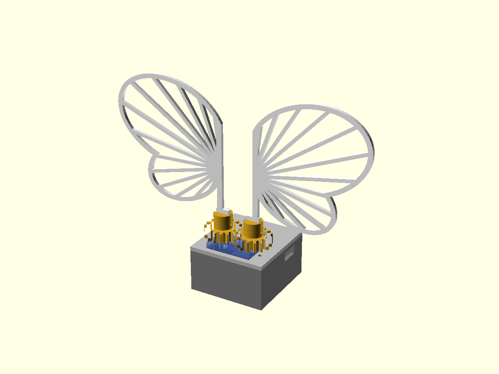

# CAD

Original parametric design in OpenSCAD (`butterfly.scad`); not derived from any third-party STL.
Export everything with `./build.sh [sg90|micro2g]` (needs `openscad`); STLs land in `../stl/`.

## Mechanism

One servo turns the **drive gear** (module 1, 16 teeth, 1:1). It meshes with an **idler gear** on a
printed 2 mm pin in the lid, so the two wings turn in **opposite** directions by the same angle.
Each wing has a flat foot that slides into a slot in the gear's post. 90 degrees of servo travel
folds the wings back from fully open; the firmware default (`ANGLE_CLOSED_DEG = 90`) matches that.

| Part | File | Print | Notes |
|---|---|---|---|
| Drive gear | `gear_drive.stl` | upright, 0.12-0.16 mm layers | horn pocket underneath: trim the servo horn arm to ~6.5 mm |
| Idler gear | `gear_idler.stl` | upright | spins on the lid pin; add a drop of glue or a washer to retain |
| Wing L / R | `wing_left.stl`, `wing_right.stl` | flat, 1.6 mm | PLA is fine; keep the rim 3 perimeters |
| Case tray | `case_base.stl` | upside-down not needed | battery cradle, USB-C and switch openings, strap slots in the floor |
| Case lid | `case_lid.stl` | upside-down | holds the servo by its flange, OLED window, board retainers, idler pin |

## Before you print: measure and edit

Every dimension that depends on a part you own is a **typical value, not a measurement**. Calipers,
then edit the marked (`VERIFY`) variables at the top of `butterfly.scad`:

- servo preset (`sg90` = SG90/SG92R class, `micro2g` = placeholder for the 2 g servo, **unverified**)
- ESP32-C3 board outline, OLED glass height, OLED window offset, USB-C position
- LiPo size, horn hub diameter/thickness

Print the gears and one wing first and test-fit before printing the case.

## Known limitations

- Not yet test-printed or fitted to real parts.
- Touch-pad window for the TTP223 is not modelled yet (mount the module on the outside of the
  -X wall, or use the button in Phase 1).
- The case is sized for the SG92R/MG90S class servo (Phase 1); the 2 g servo needs the `micro2g`
  preset re-measured and will give a much smaller case.
